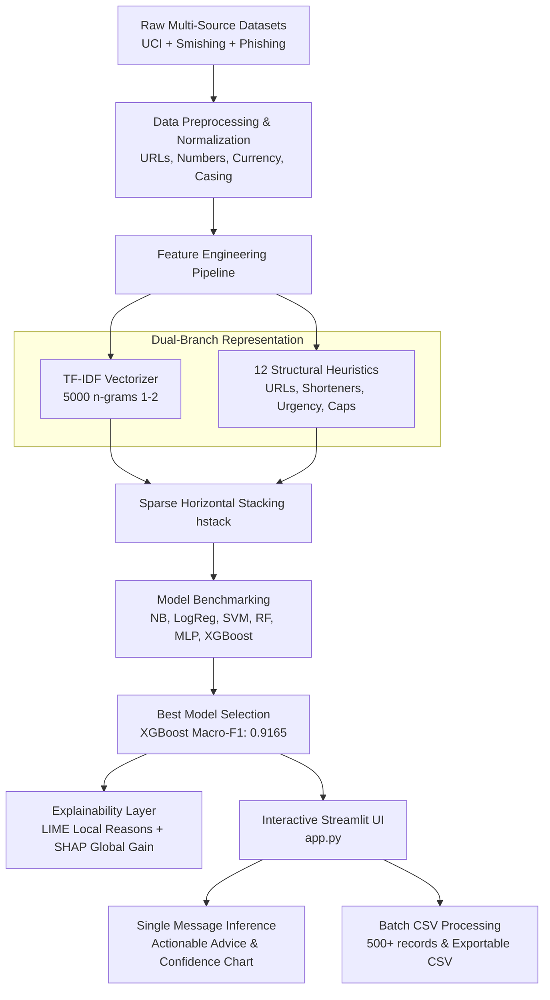

# 🛡️ 3-Class Scam & Spam Message Detection Using NLP & Machine Learning

[](https://www.python.org/)
[-green.svg)](https://xgboost.readthedocs.io/)
[](https://streamlit.io/)
[](https://github.com/slundberg/shap)
[](LICENSE)

An end-to-end Machine Learning pipeline that moves beyond traditional binary spam filtering by implementing a **3-Class Architecture** to detect and differentiate:
1. **`legitimate`**: Genuine personal and transactional communication.
2. **`promotional_spam`**: Harmless commercial offers, flash sales, and marketing broadcasts.
3. **`scam_smishing`**: High-risk financial fraud, fake KYC suspension threats, credential harvesting, and phishing links.

---

## 👥 Authors & Academic Credentials

* **Course**: Machine Learning Laboratory (CAT-2 Project Work)
* **Semester**: Semester 5
* **Project Team**:
  * **Vignesh S K** (Reg. No: 2403717673721046)
  * **Devi Prasath G** (Reg. No: 2403717673721011)
  * **Arul Ronal X** (Reg. No: 2403717673721050)

---

## 📌 Executive Summary & Problem Formulation

Standard industry filters and academic datasets (like the UCI SMS Spam Collection) treat spam as a simplistic **binary classification problem** (`spam` vs. `ham`). In real-world enterprise and telecom environments, this causes critical failures:
* Collapsing harmless marketing SMS and predatory smishing into the same bucket leads either to **financial loss** (when missed scams enter the inbox) or **customer friction** (when legitimate promotions are blocked).
* Traditional blacklists and static keyword filters fail against zero-day URL shorteners (`bit.ly`, `tinyurl.com`), spoofed sender IDs, and evolving psychological urgency cues.

### Our Solution
1. **78,000+ Unified Message Corpus**: Synthesized from multiple sources (UCI, Multi-Source Smishing datasets, Phishing archives).
2. **Dual-Branch Feature Engineering**: Combining **5,000 TF-IDF n-grams (1-2)** with **12 Domain-Specific Heuristic/Structural Features** (URL presence, shortener detection, urgency regex triggers, capital letter ratios, phone patterns, and currency indicators).
3. **Exhaustive Multi-Model Benchmarking**: 6 algorithms evaluated under Macro-F1 across severe class imbalance.
4. **Transparent Explainability (XAI)**: Integrated **LIME** local feature contributions and **SHAP** TreeExplainer global feature impact.
5. **Interactive Streamlit Web Dashboard**: Real-time single message classification with reasoning and batch CSV evaluation with exportable reports.

---

## 🏗️ End-to-End System Architecture



---

## 📊 Comprehensive Model Benchmarks

All models were evaluated on an independent test set of **15,662 stratified messages** using standard classification metrics:

| Model | Accuracy | Precision (Macro) | Recall (Macro) | F1-Score (Macro) | Primary Advantage / Behavior |
| :--- | :---: | :---: | :---: | :---: | :--- |
| **XGBoost (Best)** | **95.22%** | **0.9261** | **0.9080** | **0.9165** | **Optimal boundary between structural cues and text n-grams** |
| **MLP (Baseline)** | 95.13% | 0.9219 | 0.9014 | 0.9111 | Strong dense representation capacity |
| **Random Forest** | 94.06% | 0.9109 | 0.8642 | 0.8838 | High precision on scam, slightly conservative recall |
| **Linear SVM** | 93.07% | 0.8724 | 0.8933 | 0.8821 | Robust linear margin separation |
| **Logistic Regression** | 84.65% | 0.7541 | 0.8044 | 0.7648 | Baseline linear model with balanced weighting |
| **Multinomial Naive Bayes** | 85.84% | 0.8028 | 0.7376 | 0.7625 | Fast text-only baseline (struggles with structural cues) |

### Best Model (XGBoost) Class-Wise Performance

| Class | Precision | Recall | F1-Score | Support (n) | Business Consequence |
| :--- | :---: | :---: | :---: | :---: | :--- |
| **`legitimate`** | **96.9%** | **97.6%** | **0.973** | 8,990 | Minimal inbox friction for genuine messages |
| **`scam_smishing`** | **94.6%** | **95.4%** | **0.950** | 5,243 | **High fraud recall: captures 95.4% of aggressive smishing** |
| **`promotional_spam`** | 86.4% | 79.4% | 0.827 | 1,429 | Correctly separated into soft notifications rather than blocking |

---

## 🔍 Model Explainability & Interpretability (XAI)

Black-box classification is unacceptable for security-critical telecom applications. This project integrates two explainability layers:

1. **LIME (Local Interpretable Model-agnostic Explanations)**:
   * Explains individual message classifications directly in the UI.
   * Identifies specific words driving malicious scores (e.g., `otp`, `verify`, `blocked`, `kyc`, `immediate`, `claim`).
2. **SHAP (SHapley Additive exPlanations) & XGBoost Gain**:
   * Quantifies the global impact of features across the test partition.
   * **Top Contributing Signals**: `off`, `urgency_hits`, `has_url`, `url_count`, `word_count`, `msg_length`, `download`, `stores`, `rs`, `fee`.

---

## 🚀 Interactive Streamlit Application Features

* **Quick Preset Examples**: One-click testing for Legit, Promo, and Scam templates.
* **Instant Inference Engine**: Classifies custom SMS text with color-coded safety badges (`green`, `orange`, `red`).
* **Prescriptive Action Directives**:
  * *Legitimate*: "Safe to read and reply."
  * *Promotional Spam*: "Marketing message. Unsubscribe or ignore."
  * *Scam/Smishing*: "CRITICAL RISK: Do not click links, share OTPs, or call back."
* **Decision Explainability Drawer**: Shows exact trigger tokens and underlying normalized representations.
* **Structural Signal Inspector**: Displays parsed JSON containing URL counts, urgency hits, and uppercase ratios.
* **Bulk Batch CSV Processing**: Evaluates CSV datasets with live preview and downloadable classification reports.

---

## 📂 Project Directory Structure

```plaintext
project/
├── .gitignore                           # Production Git ignore rules
├── app.py                               # Streamlit UI & Interactive Inference Dashboard
├── requirements.txt                     # Pinned project dependencies
├── README.md                            # Comprehensive project documentation
├── FINAL_PROJECT_REPORT.md              # Complete Academic Project Report (Phases I-III)
├── Final_Project_Report_Phases_I_II_III.docx # Formatted Word report for submission
├── PRESENTATION_AND_VIVA_GUIDE.md       # 12-Slide deck outline & 20 Viva Q&A questions
├── Project_Presentation_Deck.pptx       # Ready-to-present PowerPoint slide deck
├── run_phase1.py                        # Phase 1: Data consolidation, preprocessing & EDA
├── run_phase2.py                        # Phase 2: Dual feature extraction & model training
├── run_phase3.py                        # Phase 3: Evaluation, LIME/SHAP & business insights
├── src/
│   ├── __init__.py
│   ├── preprocess.py                    # NLP cleaning, regex tokenization & normalization
│   ├── features.py                      # 12 structural/heuristic signal extractors
│   └── predict.py                       # Unified production prediction endpoint
├── models/
│   └── best_model.pkl                   # Serialized XGBoost bundle (vectorizer + encoder + model)
├── data/
│   ├── batch_test_sample.csv            # Sample test messages for batch UI evaluation
│   ├── raw/                             # Raw source datasets
│   └── processed/                       # Cleaned dataset (clean.csv)
└── outputs/
    ├── metrics.csv                      # Comparative model performance table
    ├── per_class_report.csv             # Per-class precision, recall, and F1
    ├── misclassified.csv                # Complete test error analysis audit
    ├── business_insights.txt            # Industry & telecom deployment guidelines
    ├── top_features.csv                 # Top 25 global importance features
    ├── lime_examples.json               # Exported LIME token explanations
    └── plots/                           # High-resolution visualization charts (19 plots)
        ├── 01_class_balance.png
        ├── 02_length_by_class.png
        ├── 03_structural_cues.png
        ├── 04_urgency.png
        ├── 05a_topwords_legitimate.png
        ├── 05b_topwords_promotional_spam.png
        ├── 05c_topwords_scam_smishing.png
        ├── 06_top_features.png
        ├── cm_XGBoost.png
        ├── cm_normalized_best.png
        ├── lime_scam_smishing.png
        └── shap_summary.png
```

---

## 🛠️ Installation & Setup Guide

### 1. Clone the Repository
```bash
git clone https://github.com/<YOUR_USERNAME>/scam-message-detection.git
cd scam-message-detection
```

### 2. Create and Activate a Virtual Environment
```bash
# Windows
python -m venv venv
venv\Scripts\activate

# macOS / Linux
python3 -m venv venv
source venv/bin/activate
```

### 3. Install Dependencies
```bash
pip install -r requirements.txt
```

### 4. Run the Streamlit Application
```bash
streamlit run app.py
```
*The app will automatically open in your default browser at `http://localhost:8501`.*

---

## 🔄 Pipeline Reproduction (Optional)

To re-run the entire pipeline from scratch:

```bash
# Step 1: Preprocessing & Exploratory Data Analysis
python run_phase1.py

# Step 2: Model Training & Benchmark Evaluation
python run_phase2.py

# Step 3: Deep Result Analysis, Explainability (LIME/SHAP) & Business Insights
python run_phase3.py
```

---

## ☁️ 1-Click Cloud Deployment (Streamlit Community Cloud)

1. Push this repository to your GitHub account.
2. Visit [share.streamlit.io](https://share.streamlit.io/) and log in with GitHub.
3. Click **"New app"**, select your repository, branch (`main`), and set Main file path to `app.py`.
4. Click **"Deploy"**! Streamlit Cloud will automatically install `requirements.txt` and host your live application for free.

---

## 📜 Academic Rubric Mapping (40 / 40 Marks)

| Phase | Component | Deliverable Location |
| :--- | :--- | :--- |
| **Phase I (5 M)** | Problem Identification & Survey | `FINAL_PROJECT_REPORT.md` (Ch. 1) & `Phase_I_Scam_Message_Detection_Report.docx` |
| **Phase II (5 M)** | Preprocessing and EDA | `run_phase1.py`, `src/preprocess.py`, `outputs/plots/01-05` |
| **Phase II (5 M)** | Model Building | `run_phase2.py`, `outputs/metrics.csv`, `models/best_model.pkl` |
| **Phase II (5 M)** | Result Analysis & Insights | `run_phase3.py`, `outputs/business_insights.txt`, `outputs/plots/cm_*.png` |
| **Phase II (5 M)** | UI & Backend Connectivity | `app.py`, `src/predict.py`, `data/batch_test_sample.csv` |
| **Phase III (5 M)** | Deployment and Demo | Streamlit Cloud Ready, `app.py` UI with single & batch inference |
| **Phase III (5 M)** | Presentation and Viva | `Project_Presentation_Deck.pptx`, `PRESENTATION_AND_VIVA_GUIDE.md` |
| **Phase III (5 M)** | Report and GitHub Link | `Final_Project_Report_Phases_I_II_III.docx`, `FINAL_PROJECT_REPORT.md`, Git repo |
